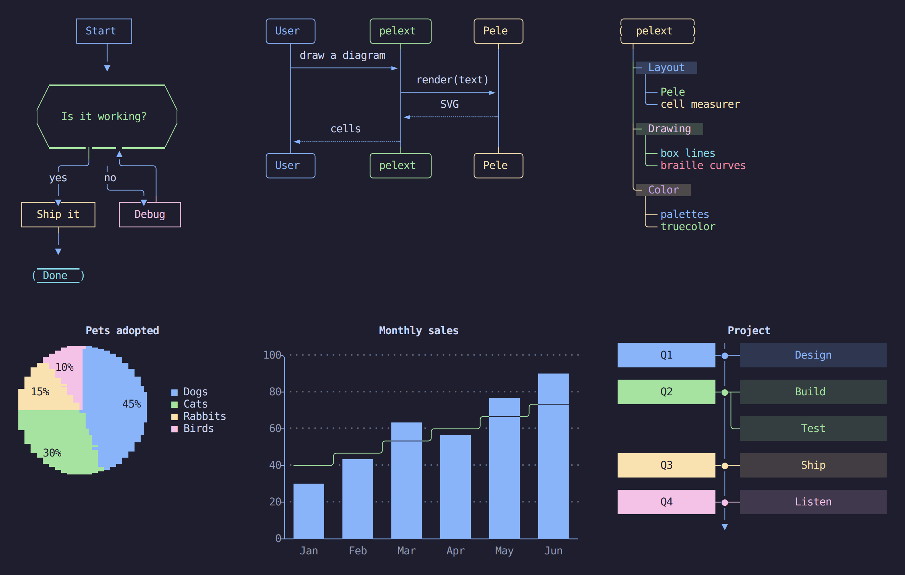
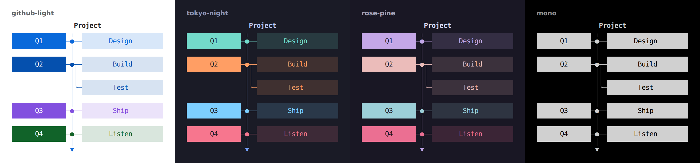

# pelext

Mermaid diagrams drawn on the terminal's cell grid. [Pele](https://pele.run) lays a diagram out as SVG, and pelext draws that layout with box-drawing lines, block fills, braille curves and real text, in 24-bit color or plain characters. It needs nothing but a terminal. pelext is the diagram engine of [cellsmith](https://github.com/4our4ace/cellsmith), packaged as a library and a command.

> [!NOTE]
> - **Independent.** pelext uses Pele's public API. It is not affiliated with or endorsed by Obsidian or the Pele project.
> - **Agent-coded.** Everything here (code, tests and these docs) was written and reviewed entirely by AI coding agents.



## Try it

Node 20 or newer. npm installs Pele along with pelext.

```sh
npx github:4our4ace/pelext diagram.mmd
npx github:4our4ace/pelext diagram.mmd --theme tokyo-night --cols 80
printf 'flowchart LR\n  A[Text] --> B[Pele] --> C[pelext]\n' | npx github:4our4ace/pelext
```

| Option | What |
| --- | --- |
| `--theme <name>` | one of 16 palettes, default `catppuccin-mocha`; `mono` draws without color |
| `--cols <n>` | the width to fit, default the terminal's |
| `--plain` | characters only, no escape codes |

With several files it draws each under its name. It exits with 1, and says which file on stderr, when a diagram does not parse or does not fit.



## Use it as a library

```sh
npm install github:4our4ace/pelext pele
```

```js
import { drawPele, toAnsi } from 'pelext'
import { PALETTES } from 'pelext/palettes'
import { render } from 'pelext/pele'

const art = drawPele(render, source, PALETTES['tokyo-night'], process.stdout.columns)
console.log(art ? toAnsi(art).join('\n') : source)
```

| Export | What |
| --- | --- |
| `drawPele(render, source, palette, columns)` | draws `source` in at most `columns` cells. Returns `{ type, width, rows, art }`, or `null` when Pele cannot parse it or no clean drawing fits |
| `toAnsi(art)` | one string per row, with 24-bit color escape codes |
| `PALETTES` (`pelext/palettes`) | the 16 palettes by name |
| `render` (`pelext/pele`) | Pele's `render` with the 13 diagram types below registered |

`rows` holds the drawing as spans, `{ text, fg?, bg?, bold?, inverse? }` with colors as `#rrggbb`, for UIs that style text themselves. `art` is the same drawing as plain text. A palette is `{ canvas, text?, muted?, line?, border?, accent?, critical?, highlight?, series, hues }`: `canvas` is the background the drawing sits on, and `series` and `hues` color chart series and nodes in turn.

`drawPele` takes Pele's `render` as an argument, and `dist/pelext.js` has no imports, so a project can vendor that one file next to its own Pele build, as cellsmith does.

## What it draws

Flowcharts, sequence, state, class and ER diagrams, pie charts, gantt charts, bar and line charts (`xychart`), timelines, mindmaps, quadrant charts, git graphs and sankey diagrams. `pelext/pele` registers exactly these 13 types, the ones the engine is tested on. Pele lays out more, and passing Pele's full `render` draws them too, untested.

A diagram too wide for `columns` is laid out again narrower; a left-to-right chart turns top-down and a sequence diagram wraps its labels. Labels stay real text, so a drawing copies as text.

## Develop

```sh
git clone https://github.com/4our4ace/pelext
cd pelext
npm install
npm test            # builds dist/ and runs the tests
npm run corpus      # writes about 1100 generated diagrams to corpus/
npm run compare     # draws everything with HEAD's engine and with src/, lists what changed
npm run defects     # scans every drawing for glitches: lost text, broken lines, low contrast
```

[AGENTS.md](AGENTS.md) has the layout, rules and checks. Tested on Linux (WSL).

## Credits and license

MIT, © [4our4ace](https://github.com/4our4ace). Layouts by [Pele](https://github.com/obsidianmd/pele), MIT, © kepano. The palettes come from their projects, all MIT: see [THIRD_PARTY_NOTICES.md](THIRD_PARTY_NOTICES.md).

pelext is an independent project. It is not affiliated with or endorsed by Obsidian, the Pele project or the Mermaid project.
